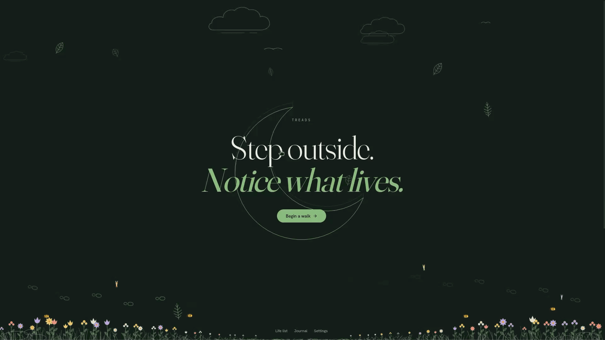
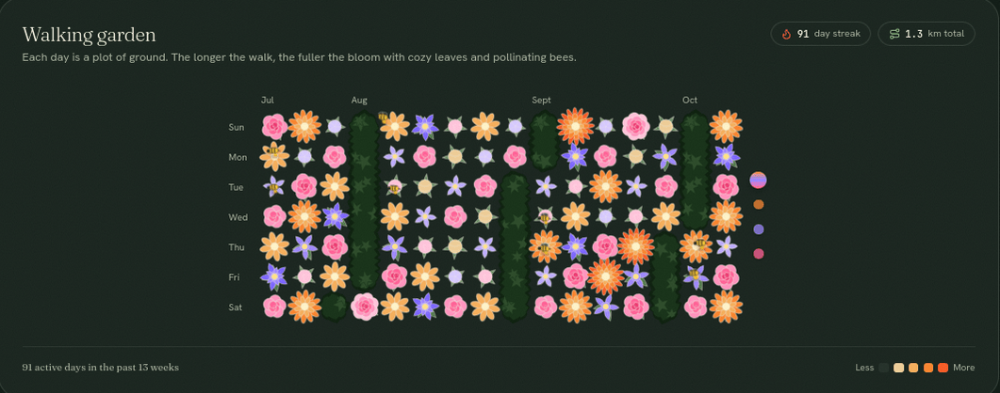
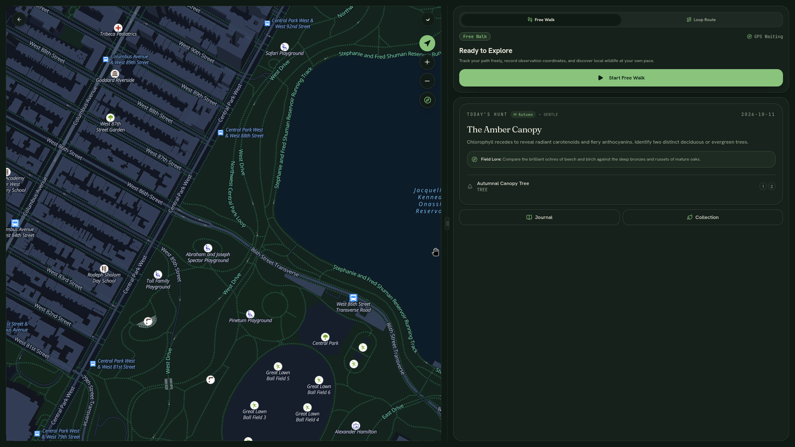

# Treads 🌿 — Hacktoberfest Touch Grass

> *Step outside. Notice what lives.*

Treads is a mindful, local-first naturalist companion designed to encourage outdoor observation and mindful walking. Built for **Hacktoberfest Touch Grass**, it turns routine neighborhood walks into observational field journals by weaving together on-device sensory experiences, pedestrian loop generation, open-weight machine intelligence, voice-recorded reflections, and seamless Obsidian vault exports.

---

## 🍃 Core Philosophy: Mindful, Grounded, and Local-First

Unlike conventional nature apps that require accounts, monetize social streams, and store location histories on remote servers, Treads is built around quiet craftsmanship and personal sovereignty:

- **100% Local-First Data Sovereignty:** Your field journal entries, specimen photographs, voice recordings, and GPS coordinates live entirely in your browser's IndexedDB (Dexie). No accounts, zero analytics trackers, and zero server-side persistence.
- **Client-Side Privacy & EXIF Stripping:** Captured specimens are rasterized directly onto an HTML5 Canvas to strip 100% of hardware and GPS metadata before any transient AI queries.
- **Open-Weight Intelligence via Gemma 4:** Powered by Google's open-weight **Gemma 4** (`gemma-4-26b-a4b-it`) across all intelligence layers—from phenology-aware taxonomic candidate ranking to grounded natural history synthesis and Aldo Leopold-style field dispatches.
- **Sensory Voice Journaling via ElevenLabs:** Hands-free field recordings are transcribed with word-level precision using **ElevenLabs Scribe STT** (`scribe_v1`), while natural history notes can be read aloud in the field via warm, studio-grade narration powered by **ElevenLabs Multilingual v2** (`eleven_multilingual_v2`).
- **Tactile Sensory Cues:** Synthesized Web Audio dual-oscillator chimes (E5–G#5 major-third capture chime, C5–E5–G5–C6 celebration arpeggio), Japanese Tegaki ink handwriting reveals (`Caveat`), and native haptic pulses ground digital interactions into calming outdoor rituals.

---

## 🗺️ Application Overview & Features

Treads organizes the naturalist experience across a focused set of views:

- **The Field Hearth (`/`):** Launch walks by selecting a loop duration goal (15m, 30m, 45m), view your active streak and field statistics, and discover the rotating **Daily Species Hunt** challenge across birds, trees, wildflowers, and fungi.

- **Active Field Walk (`/walk`):** Full-screen MapLibre GL outdoor topography maps with OpenRouteService pedestrian loops, background-resilient GPS trail tracking with 35m accuracy filtering, two-tap camera capture with instant canvas EXIF stripping, live-waveform voice recorder drawer, and a pocket-safe hold-to-finish confirmation dock.
- **Herbarium & Life List (`/collection`):** A visual catalog of all flora, fauna, and fungi documented on your walks, filterable by taxonomic kingdom with instant local search across common and binomial names.
- **Field Logbook (`/journal` & `/journal/[walkId]`):** Review past expeditions with route trail replays, elevation metrics, specimen finds, and one-tap **Obsidian-Compatible Vault Export** (producing a zipped archive of Markdown notes with YAML frontmatter, photos, and JSON backups).
- **Specimen Note (`/entry/[id]`):** High-resolution photo inspection, candidate species re-identification, grounded Wikipedia natural history cards with citations, tactile *"Look Closely"* sensory observation prompts, and studio-grade ElevenLabs voice narration.
- **Preferences & Sovereignty (`/settings` & `/privacy`):** Control audio chimes, native haptics, and durable browser storage persistence, or review the transparent data manifesto explaining our zero-server data model.
- **Developer & Benchmark Tools (`/eval` & `/spike`):** Interactive 30-fixture batch taxonomic evaluation dashboard and live hardware diagnostic suite for sensors, audio, and AI pipelines.


 




---  
## 📊 Evaluation & Verification Benchmark

Treads includes a headless 30-fixture evaluation harness (`scripts/run-eval-suite.ts`) validating organism classification and honest refusal:
- **Living Organism Fixtures:** 20 test specimens spanning trees, wildflowers, birds, insects, and fungi.
- **Negative Refusal Fixtures:** 10 non-organism and human subjects (bicycles, coffee mugs, asphalt, park benches, water bottles, human portraits, outdoor selfies).

### Benchmark Criteria & Live Gemma 4 Results:
| Metric | Benchmark Target | Live Gemma 4 (`gemma-4-26b-a4b-it`) | Deterministic Mock Engine |
| :--- | :--- | :--- | :--- |
| **Organism Accuracy** | ≥ 70.0% | **95.0%** (19 / 20) | **100.0%** (20 / 20) |
| **Honest Refusal Rate** | ≥ 90.0% | **100.0%** (10 / 10) | **100.0%** (10 / 10) |
| **Average Latency** | — | **~2,086 ms** | **~14 ms** |

Run the headless benchmark locally:
```bash
# Offline deterministic benchmark
pnpm test:eval

# Live benchmark with Gemma 4 (requires GOOGLE_GENERATIVE_AI_API_KEY in .env.local)
pnpm tsx --env-file=.env.local scripts/run-eval-suite.ts
```

> **Note on Fixtures:** The 30 evaluation fixtures in `public/eval-fixtures/` use stylized SVG illustrations for deterministic, portable, offline-capable verification across test runners without multi-megabyte binary dependencies.

---

## 🛠️ Tech Stack

- **Framework:** Next.js 16.4 (App Router, Turbopack) & React 19
- **Open-Weight AI:** Google Gemma 4 (`gemma-4-26b-a4b-it`) via `@ai-sdk/google` & Vercel `ai` SDK
- **Voice & Speech:** ElevenLabs Scribe STT (`scribe_v1`) & ElevenLabs Multilingual TTS (`eleven_multilingual_v2`)
- **UI & Tokens:** Tailwind CSS v4, Base UI primitives, Lucide React, Japanese Tegaki ink styling (`Caveat` font), and Hairline isometric line figures
- **Database:** Dexie 4.4 (IndexedDB) with `dexie-react-hooks`
- **Mapping & Routing:** MapLibre GL 6.13 with OpenFreeMap vector tiles and OpenRouteService pedestrian routing
- **Sensory Audio & Motion:** Web Audio API (Cuelume dual-oscillator synthesizer) & Motion (Framer Motion)
- **Data Export:** JSZip for Obsidian Markdown + YAML vault bundling

---

## 🚀 Getting Started

### 1. Install Dependencies
```bash
pnpm install
```

### 2. Configure Environment Variables
Create a `.env.local` file with your API keys (see `.env.example`):
```bash
# Google AI Studio (Open-Weight Gemma 4)
GOOGLE_GENERATIVE_AI_API_KEY=your_gemini_or_gemma_api_key
IDENTIFY_MODEL_ID=gemma-4-26b-a4b-it
FACTS_MODEL_ID=gemma-4-26b-a4b-it

# ElevenLabs (Voice transcription & high-fidelity narration)
ELEVENLABS_API_KEY=your_elevenlabs_api_key

# OpenRouteService (Pedestrian loop round trips)
ORS_API_KEY=your_ors_api_key

# Optional: Upstash Redis (Server rate-limiting; uses in-memory in development)
UPSTASH_REDIS_REST_URL=
UPSTASH_REDIS_REST_TOKEN=
```

### 3. Run Development Server
```bash
pnpm dev
```
Open [http://localhost:3000](http://localhost:3000) in your browser.

### 4. Run the Evaluation Suite
```bash
pnpm test:eval
```

### 5. Production Build
```bash
pnpm build
```

---

## 🌿 Field Verification Protocol

For the complete 8-step outdoor field walkthrough protocol covering GPS tracking, photo capture, EXIF stripping, voice transcription, and Obsidian export, refer to [`FIELD-VERIFICATION.md`](./FIELD-VERIFICATION.md).

---

## 📜 License
MIT License

---


---